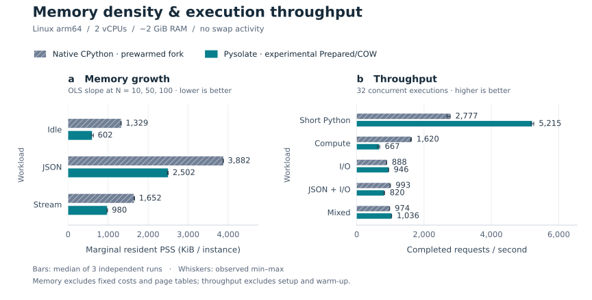

# Pysolate

Python sandbox for AI agents, embedded in Go. Runs CPython + NumPy through
WebAssembly/WASI, with a fresh Guest for each execution.

## Features

- **Code mode:** Python scripts call Host-provided Go functions and MCP tools.
  Credentials and network clients stay in the Host. [Tools](docs/mcp.md)
- **Private workspaces:** bounded filesystems shared across successive executions,
  with snapshots, diffs and change export. [Workspace](docs/workspace.md)
- **Versioned inputs:** immutable read-only file views, explicit Host updates and
  optional FS access records without full-tree hashing. [Files](docs/versioned-files.md)
- **Prepared execution:** reuse compiled code and initialized Python state through
  full-copy images or Linux COW mappings. [COW](docs/cow-data-image.md)
- **Concurrent I/O:** overlap explicitly approved independent reads; release
  execution slots during opted-in external Tool waits.
  [Early reads](docs/fullcode-tool-overlap.md) · [Scheduling](docs/scheduling-evaluation.md)
- **Replay and recovery:** persist Tool outcomes, reconstruct interrupted runs and
  resume according to each Tool's declared recovery policy. [Durability](docs/execution-derived-durability.md)
- **Go API, CLI and HTTP service**, with execution deadlines and bounded admission.
  [Service](docs/service.md) · [Durable service](docs/durable-service.md)

Host tools enforce their own authorization. External effects require provider
recovery support; writable workspaces are excluded from durable replay.

## Run

Requires Go 1.25+ and `dist/pysolate.wasm`.
[Build the Guest or install a verified bundle](docs/artifact-profiles.md).

```sh
printf 'result = inputs["value"] + 1\n' | go run ./cmd/pysolate -inputs '{"value":41}'
go run ./examples/python-tools -guest dist/pysolate.wasm
./demos/run-core.sh
```

Scripts receive `inputs`, assign their output to `result`, and call the tools
granted by the Host:

```python
quotes = [market.get_price(symbol=s) for s in inputs["symbols"]]
result = max(quotes, key=lambda quote: quote["price"])
```

[Go embedding example](examples/python-tools/main.go) ·
[All demos](demos/README.md) · [Agent loop](docs/agent-loop.md)

## Performance

Linux arm64, 2 vCPUs, ~2 GiB RAM, no swap activity; medians of three runs.
Native uses prewarmed CPython 3.14.7 + fork. Pysolate uses the **experimental
optimized runtime**, CPython 3.14.0 + Prepared/COW + checked poll1024; these
optimizations are not all integrated into this repository's default runtime.

[][native-comparison]

<details>
<summary>Measurements, workloads and p99 latency</summary>

**Resident memory growth**, whole-service PSS fitted over 10/50/100 instances:

| Workload | Native KiB/instance | Pysolate KiB/instance |
|---|---:|---:|
| Idle | 1,328.9 | 601.8 |
| JSON, 5,000 retained records | 3,881.8 | 2,501.5 |
| Stream, 8 × 256 records, retain last page | 1,651.5 | 979.8 |

Page tables are counted separately in the report. Pysolate has a larger fixed
memory cost; at 10 instances its total PSS is higher.

**Throughput and request latency**, 32 concurrent single-use executions,
setup and warm-up excluded:

| Workload | Native req/s | Pysolate req/s | Native p99 ms | Pysolate p99 ms |
|---|---:|---:|---:|---:|
| Short Python, sum of 32 squares | 2,776.7 | 5,215.4 | 29.27 | 9.89 |
| Compute, sum of 20,000 squares | 1,619.7 | 666.7 | 38.36 | 42.79 |
| I/O, 3 × 10 ms tools, 16 rows each | 888.2 | 946.4 | 68.76 | 35.38 |
| JSON + I/O, 2 × 1 ms tools, 1,024 rows each | 992.8 | 819.8 | 52.07 | 47.52 |
| Mixed, 90% I/O + 10% compute | 973.7 | 1,036.3 | 65.10 | 35.23 |

Native forks and reaps a child per request; Pysolate creates and closes a Guest.
Native runs trusted fixtures without an adversarial sandbox. The full comparison
covers C1–32, CPU/request and open-loop queueing: **288 cells, 390,836 successful requests**.

</details>

[Report, raw data and reproduction][native-comparison] ·
[Figure source](docs/figures/runtime-cost/README.md) ·
[Default-runtime performance](docs/performance-results.md) ·
[Benchmark catalog and experiment entry points](docs/benchmarks.md) · [Documentation](docs/README.md)

[native-comparison]: https://github.com/bkmashiro/pysolate-spine/tree/1908514a55f524289146bad5c9b3e7a24ef5c688/experiments/runtime-cost/compare/evidence/linux-arm64-20261012

## Benchmark suites

| Scope | Reports and reproduction |
|---|---|
| Native vs Pysolate: memory slopes, throughput, CPU and tails | [Matched comparison][native-comparison] · [one-command suite](https://github.com/bkmashiro/pysolate-spine/tree/92cb647c774f04c75f3b5949ebbaab54bcb0e677/experiments/runtime-cost/compare) |
| COW, allocator, engine metadata, residency and Host ABI | [Experimental suites](docs/benchmarks.md#experimental-runtime-measurements) |
| Default runtime, startup, imports and HTTP service | [Performance](docs/performance-results.md) · [hotspots](docs/performance-dissection.md) |
| I/O scheduling and early reads | [Scheduling](docs/scheduling-evaluation.md) · [contention](docs/early-read-contention.md) |
| Common workloads, model/tool behavior and code reuse | [Workloads](docs/workload-pack.md) · [agent evaluation](docs/agent-evaluation.md) · [full catalog](docs/benchmarks.md) |

Spine experiment links require access to its private GitHub repository.
Cache/fault-recovery follow-ups, named Guest/JIT attribution, frozen/minimalfs and
compile-seed experiments remain local; [unpublished studies](docs/benchmarks.md#completed-experiments-still-local)
lists their exact revisions. The catalog distinguishes source, raw results and Guest build inputs.

## Test

```sh
make check
make workloads
```

Real-Guest tests require the Wasm artifact. COW tests require Linux.
